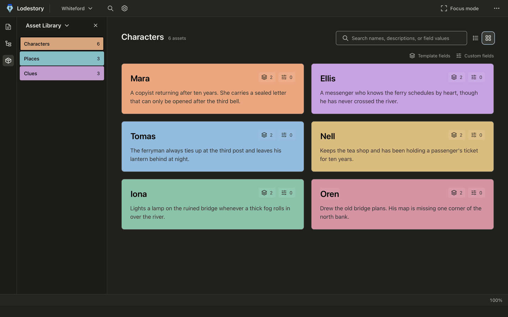

<p align="center">
  
</p>

<h1 align="center">Lodestory</h1>

<p align="center">
  <strong>English</strong> · <a href="README.zh-CN.md" lang="zh-CN">简体中文</a>
</p>

<p align="center">
  A local desktop app for writing novels and other long-form stories. Draft chapters, organize characters and worldbuilding notes, and map story events in one project.
</p>

<p align="center">
  <a href="#getting-started">Getting started</a> ·
  <a href="#plugins-and-architecture">Plugins and architecture</a> ·
  <a href="文档/桌面版打包.md">Build installers (Chinese)</a>
</p>



## Features

- **Draft chapters.** Organize TXT manuscripts into folders and switch between them in tabs. Edits save automatically to your local project folder.
- **Keep track of characters and worldbuilding.** Group characters, places, and other story details by type. Define fields for each type and record relationships between entries.
- **Outline the story visually.** Arrange events on a zoomable timeline, mark turning points, and link events to characters and places.
- **Search the project.** Search manuscript text, story details, and timeline events. Open any result to jump to its location.

## Getting started

Install Node.js 24, pnpm 8.10.2, and the development dependencies for your operating system. Run these commands from the repository root. [Tauri prerequisites](https://v2.tauri.app/start/prerequisites/)

```sh
pnpm install --frozen-lockfile
pnpm dev:desktop
```

From the welcome screen, start a new story or open an existing project folder. In the project, select **+** in the file tree to create a TXT manuscript. Choose **English** under **设置 → 语言** (Settings → Language) to switch the interface language.

## Plugins and architecture

Plugins implement features such as manuscript editing, timelines, and asset management. They work together through public interfaces. The core handles plugin dependencies, activation, and cleanup.

Use **Settings → Plugins** in the desktop app to import local ZIP packages and enable, disable, or uninstall them. External plugins can add content to the workbench layout and contribute pages to the app navigation.

- [Architecture overview (Chinese)](文档/一切皆插件架构.md)
- [Public SDK (Chinese)](packages/sdk/README.md) · [Plugin project template (Chinese)](packages/create-plugin/README.md) · [Loading external plugins (Chinese)](src/plugins/external-plugins/README.md)

## Development and tests

Lodestory uses Tauri 2 on the desktop and React and TypeScript for the frontend. Run `pnpm dev` to start the frontend dev server and watch for changes to the SDK and UI component library. [UI component library (Chinese)](packages/ui/README.md)

```sh
pnpm test
cargo test --manifest-path src-tauri/Cargo.toml
pnpm test:desktop
```

Desktop tests use a separate debug build and configuration directory. Run `pnpm test:desktop --spec tests/desktop/smoke.spec.mjs` to select a test file.
