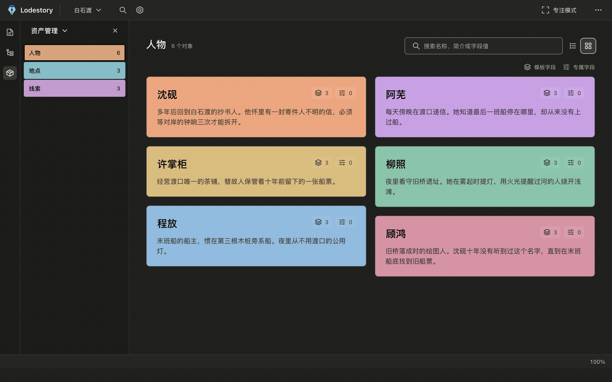

<p align="center">
  
</p>

<h1 align="center">Lodestory</h1>

<p align="center">
  <a href="README.md" lang="en">English</a> · <strong>简体中文</strong>
</p>

<p align="center">
  面向小说与长篇创作的本地桌面工作台。在同一个项目里写正文、整理人物与设定、梳理故事时间线。
</p>

<p align="center">
  <a href="#快速开始">快速开始</a> ·
  <a href="#插件与架构">插件与架构</a> ·
  <a href="文档/桌面版打包.md">构建安装包</a>
</p>



## 核心功能

- **正文写作**支持按目录整理 TXT 文稿，用标签页切换。编辑内容自动保存到本地项目文件夹。
- **人物与设定**可按类型整理。你可以为不同类型的资料自定义字段，记录人物、地点等资料之间的关系。
- **故事时间线**可缩放，支持排列事件、标记关键转折，并关联事件涉及的人物和地点。
- **项目搜索**覆盖文稿正文、设定资料和时间线事件，从搜索结果可直接跳到对应位置。

## 快速开始

准备好 Node.js 24、pnpm 8.10.2 和当前系统的开发依赖，再在仓库根目录运行以下命令。 [Tauri 环境准备](https://v2.tauri.app/start/prerequisites/)

```sh
pnpm install --frozen-lockfile
pnpm dev:desktop
```

启动后选择「开始新创作」或「打开已有作品」。进入项目后，在文件树中点击「+」即可新建 TXT 文稿。

## 插件与架构

Lodestory 按「一切皆插件」组织。正文编辑、时间线、资产管理等功能各自由插件维护，插件通过公开接口协作，内核负责通用的插件运行机制。

桌面版可在「设置 → 插件」导入本地 ZIP 插件包，并管理启用、停用和卸载。外部插件目前可接入工作台布局和应用导航页面。

- [架构说明](文档/一切皆插件架构.md)
- [公开 SDK](packages/sdk/README.md) · [插件开发脚手架](packages/create-plugin/README.md) · [外部插件加载](src/plugins/external-plugins/README.md)

## 开发与验证

桌面端使用 Tauri 2，前端使用 React 和 TypeScript。`pnpm dev` 启动前端开发服务并监听 SDK 和 UI 组件库的改动。 [UI 组件库文档](packages/ui/README.md)

```sh
pnpm test
cargo test --manifest-path src-tauri/Cargo.toml
pnpm test:desktop
```

桌面端测试使用隔离的调试构建与配置目录。可以用 `pnpm test:desktop --spec tests/desktop/smoke.spec.mjs` 指定测试文件。
