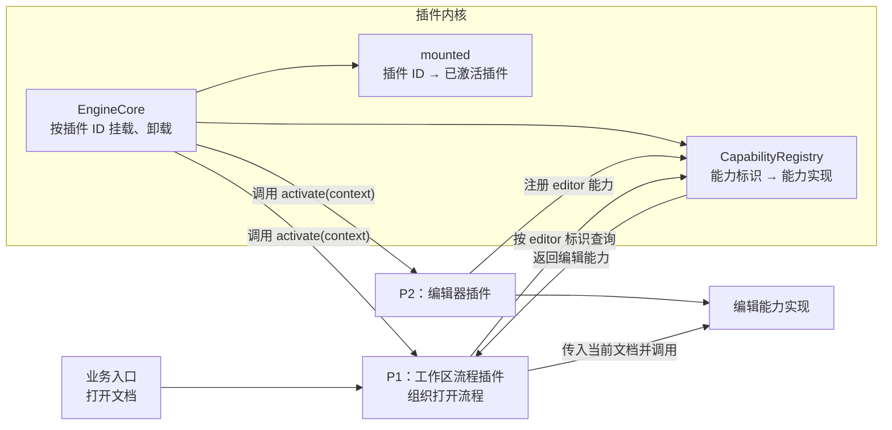

# 一切皆插件架构

## 一句话理解

**Core 管插件的生命周期，C 管能力的查找，P 实现能力或组织业务流程。插件之间通过事先约定的接口和事件协作。**

“一切皆插件”表示主要业务能力和业务流程都可以按统一规则装配、替换和卸载；不是把每一个函数都做成插件，也不是让系统自动理解任意插件的内部代码。

## 1. 最小骨架：Core、C、P

| 部分 | 职责 | 不负责什么 |
| --- | --- | --- |
| Core（插件运行时） | 挂载、记录、停用和卸载插件；在能力依赖得到满足后激活插件；清理插件留下的注册 | 规定每项业务的具体执行步骤 |
| C（能力注册表；TypeScript 类名 `CapabilityRegistry`） | 保存当前上下文中已注册的“能力标识 → 能力实现及提供者”对应关系，供插件查询 | 自动推断业务需要什么能力，或查找尚未加载的插件 |
| P（插件） | 实现业务能力，或按业务规则调用其他能力；可向 C 注册能力，也可从 C 获取能力 | 绕过约定，直接读取其他插件的私有实现 |

Core 要保存**已挂载插件对象**，这样才能在卸载时调用它的停用逻辑；C 保存的是插件对外提供的**能力**，不要求把整个插件对象当作能力存进去。业务真正调用的是能力接口，不是 Core 逐次代替业务调用插件。

最小运行过程：

```text
Core 挂载 P → P 向 C 注册能力 → 其他插件从 C 查询并调用能力 → Core 卸载 P，撤销注册
```

以“打开文档”为例，插件管理和业务调用是两条不同的路径：



`mounted` 按插件 ID 保存已激活的插件实例，供 `EngineCore` 卸载；`CapabilityRegistry` 按能力标识保存插件显式提供的实现，供业务查询。图中的工作区和编辑器插件是后续接入示例，当前尚未接入 Lodestory 业务。

## 2. 插件怎么知道要调用谁：先定义能力契约

先由开发者根据业务需求定义能力契约，包括**能力名称、调用接口、输入输出和错误**。例如 `editor.save(document) -> result`。新插件也可以自行定义新的能力契约，无须先修改 Core 或维护一份包含所有能力的全局枚举；但要让其他插件使用它，仍需通过接口定义、类型和文档公布这份约定。一个插件需要保存文档，就声明自己需要 `editor` 能力；至于这项能力由哪个插件提供，可以在装配时决定。

因此更准确的关系是：

```text
流程插件 P1 → 依赖 editor 能力契约 ← 编辑器插件 P2 提供实现
```

以后可以用 P3 替换 P2，只要 P3 遵守相同契约，P1 就不必跟着修改。如果 P1 确实需要 P2 独有的行为，也可以明确依赖 P2；这是一种有意选择的耦合，不会被插件架构自动消除。

依赖声明由**插件开发者编写**，Core 不会推断“P1 应该依赖谁”。

### 从依赖声明到激活

1. **声明**：插件分别声明自己需要哪些能力、对外提供哪些能力。例如 P1 声明 `requires: [editor]`，P2 声明 `provides: [editor]`。P1 依赖的是 `editor` 契约，而不一定是名为 P2 的具体插件。
2. **选择提供者**：装配时先有一组准备加载的插件，Core 才能根据声明找到提供 `editor` 的插件；如果有多个提供者，还需要明确选择规则。能力注册表只存放激活后实际注册的能力，不负责从外部发现插件。
3. **构建依赖图并激活**：Core 根据这些关系让提供者先激活、注册能力，再激活使用者。多个插件可以依赖同一能力，因此整体是**依赖图，不一定是树**。缺少提供者或出现循环依赖时，需要报告错误或按约定等待，不能假装依赖已经满足。

插件注册新能力，只表示其他插件可以按约定找到并调用它；已有业务流程不会自动知道何时使用新能力。若要让新能力参与原有流程，须由使用它的插件主动调用，或由流程预先开放相应扩展点。

## 3. 业务逻辑由谁编排

Core 只管插件生命周期。需要“先做 A，再做 B，失败时做 C”的业务流程时，由一个**流程插件**负责这些步骤。这个流程插件也遵守普通插件的规则：声明所需能力，从 C 获取能力，再按顺序调用。

例如“保存文档”流程可以是：

```text
用户触发保存
  → 保存流程插件取得 editor 能力
  → 调用 editor.save(document)
  → 根据结果更新状态或返回错误
```

流程内部还可以包含更小的步骤。哪些步骤允许其他插件参与，需要由流程的作者明确开放为能力接口或事件；插件系统无法自动进入任意一行内部代码。

## 4. 什么时候用能力接口，什么时候用事件

- **能力接口**：调用方明确需要一个结果，例如“保存文档”“读取配置”“生成文本”。调用方知道自己需要哪一类能力，但可以不知道提供者是谁。
- **事件**：某个流程运行到约定的位置，通知其他插件，或允许它们在该位置包装、拦截行为，例如“保存前”“保存后”“执行工具期间”。

通俗地说，**事件是业务流程预留的切入点**。保存文档可以开放“保存前”“保存过程中的某一步”“保存后”；编辑文本也可以开放相应位置。其他插件在这些位置接入自定义逻辑，但这些位置不会由 Core 自动生成，而要由拥有流程的插件明确设置。“保存中”这类名称还要说明具体指流程中的哪一步。

切入点能做什么也要分别定义：例如“保存后”可以只通知日志插件记录结果；“保存前”若允许校验、修改或阻止保存，就必须约定监听者的返回值和处理规则。**订阅了事件，不等于自动获得修改或中断流程的权限。**

每个切入点还要约定事件名称、携带的数据、执行顺序和错误处理。例如，保存流程在调用前后发布携带文档标识和结果的事件；日志插件订阅这些事件，就可以记录日志，而不必引用具体编辑器插件。

对于需要包住一次调用的场景，也可以设计带 `next()` 的事件或中间件：日志插件先记录“开始”，调用 `next()` 执行后续逻辑，再记录“结束”。这与代理模式中的前后拦截相近。

**边界：**如果某个插件没有开放事件，也没有通过可包装的公共接口执行，外部日志插件就无法知道它内部任意位置发生了什么。要观察该位置，必须由拥有该逻辑的插件增加扩展点，或在更外层的公共调用边界做拦截。

## 5. 上下文和公共状态

插件运行时需要一个访问入口，可称为 `Context`。它可以向插件提供能力查询、事件订阅与发布，以及业务流程需要的共享状态或服务。最小骨架中的 C 只覆盖了其中的**能力查询**部分。

共享状态应有明确的归属和访问接口。例如“当前文档”可以由文档状态服务管理，其他插件通过服务读取或修改；不需要把所有可变数据都直接塞进一个任意读写的全局 Map。插件只能使用上下文明确开放的能力与数据。

## 6. 注册、运行、卸载的完整过程

1. **设计时**：定义能力契约和需要开放的事件点；插件作者声明自己提供和依赖哪些能力。
2. **挂载时**：Core 先检查必需依赖；满足后激活插件，让它注册能力、订阅事件；激活成功后，Core 记录该插件。
3. **运行时**：流程插件从 C 获取能力并组织业务；运行到预设位置时发布事件，相关插件参与处理。
4. **卸载时**：Core 停用插件，撤销它提供的能力和事件订阅，并处理仍依赖该能力的插件。激活中途失败也需要清理已完成的注册。

把一次注册和对应的撤销操作关联起来，卸载时统一执行，就能避免留下失效的事件监听器或能力。这是“自动撤销注册”的核心思路。

## 7. 当前验证代码与后续设计的界限

`plugin-architecture-lab` 用 Rust 验证了 **Core、C、P** 的最小骨架；TypeScript 的 `src/plugin-core` 已实现 `EngineCore`、`CapabilityRegistry`、`Plugin` 和能力标识，支持挂载、能力注册与查询、卸载及失败清理。TypeScript 骨架尚未接入现有业务；**插件提供/依赖能力的声明、提供者选择、依赖图排序与自动激活、事件系统、统一 Context、事件订阅的自动撤销**仍是下一阶段的设计内容。目前需要手动按依赖顺序挂载插件。

这里的“动态挂载/卸载”首先指程序运行时管理**已经编译进程序的插件实例**；它不等同于从外部动态加载 Rust 库文件。

## 参考：DSH 的对应做法

DSH 将可替换能力拆为[接口定义、提供者和使用者](https://github.com/deepseek-ai/deepseek-harness/blob/master/docs/architecture.md)；插件通过[服务依赖声明和 Context](https://github.com/deepseek-ai/deepseek-harness/blob/master/docs/cordis-primer.md)协作。它的[工具执行流程](https://github.com/deepseek-ai/deepseek-harness/blob/master/docs/tool-execution-pipeline.md)明确设置了 `tools/pre-execute`、`tools/execute`、`tools/post-execute` 等可介入执行的切入点，并用 `tools/result` 通知最终结果；不同切入点允许的行为由各自的事件契约决定。

开发者可以查阅 DSH 的[现有能力地图](https://github.com/deepseek-ai/deepseek-harness/blob/master/docs/capability-seams.zh.md)，也可以按[服务开发说明](https://github.com/deepseek-ai/deepseek-harness/blob/master/docs/user/develop/framework/service.md)在新插件中定义新的能力。
