# 一切皆插件架构：从普通 JS 代码逐步推导

本文面向会写 JavaScript、还没接触过插件架构的开发者。我们用“保存文档”贯穿全文：先写出普通调用，再随着需求变化，逐步得到能力注册、插件管理、依赖检查和事件通知。

每一步都先说明原来的代码遇到了什么问题，再引入解决它的机制。文中用少量 TypeScript 记录接口约定；存储、保存和日志插件是教学示例，当前实现范围在文末说明。

配图紧跟对应的推导步骤，箭头旁的文字说明谁调用谁。原配图中的紫色虚框曾表示待实现的事件部分；现在事件代码已实现，图内旧状态标记以第 14 节为准。最后一张总览图再把全部关系放在一起。

子文档：[UI 插件化设计](/Users/yinzhenpu/projects/Lodestory/文档/一切皆插件架构/UI插件化设计.md)，从入口直接组装组件的问题，推导 UI 登记、装配和安全卸载；这是目标设计，尚未实现。

## 1. 从普通调用开始

假设 `writeToFile` 已经负责写入文件，保存流程直接调用它：

```js
async function saveDocument(document) {
  await writeToFile(document);
}
```

用户点击保存，页面调用 `saveDocument`，写入成功后返回，失败则抛错。

目前这就够了。保存流程直接选择了文件写入实现，还没有需要引入插件的地方。

## 2. 允许替换实现，先把固定调用改成参数

现在希望正常使用时写文件，测试时写内存，并且两边使用同一份保存流程。

如果直接把函数内部改成 `writeToMemory`，正常使用也会受影响。问题是：写入实现已经固定在保存函数里，调用者无法选择。

因此，先只做一个改动，把写入函数作为参数：

```js
async function saveDocument(document, write) {
  await write(document);
}

// 正常使用
await saveDocument(document, writeToFile);

// 测试
await saveDocument(document, writeToMemory);
```

保存流程仍然执行“交出文档，等待写入”，只是具体写入办法由外部选择。到这里，一个函数参数已经解决替换问题，不需要额外的管理机制。

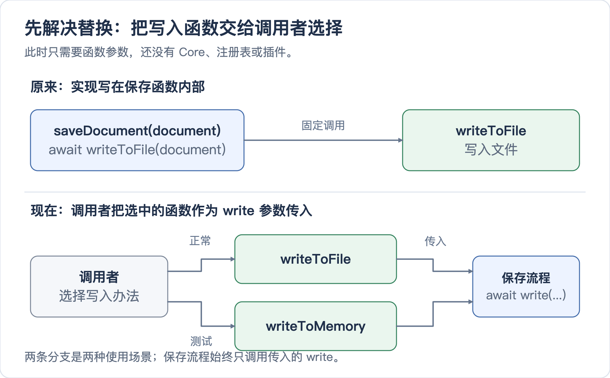

图 1：上面固定调用文件实现；下面由调用者选择实现，再交给同一份保存流程。

## 3. 可以替换之后，约定双方怎样合作

能传入不同函数，不代表任意函数都能正确完成保存。调用方需要知道：传什么数据、怎样等待完成、失败如何表达。

所以，为写入操作约定：

- 输入包含文档 ID 和正文。
- 返回 `Promise<void>`，成功完成表示写入成功。
- 写入失败时拒绝 Promise。

用类型记录这份约定：

```ts
type DocumentData = {
  id: string;
  content: string;
};

type WriteDocument = (document: DocumentData) => Promise<void>;

async function saveDocument(
  document: DocumentData,
  write: WriteDocument,
): Promise<void> {
  await write(document);
}
```

这就是**能力契约**：使用者依赖的是“怎样使用这项能力”的约定，提供者负责遵守它。文件写入和内存写入可以采用不同代码，但调用方式保持一致。

类型检查能约束输入输出，不能证明文件真的写好了。“成功完成代表写入成功”仍由实现保证，并在文档中说明。

本例的能力就是一个函数。能力也可以是一组相关方法组成的对象，是否需要对象由具体接口决定。

## 4. 把选择实现和执行保存分开

如果写入方式在启动时就已确定，页面不必在每次保存时重新传入它。我们希望启动时完成选择，运行时只传文档。

于是增加一个创建保存函数的步骤：

```ts
type SaveDocument = (document: DocumentData) => Promise<void>;

function createSave(write: WriteDocument): SaveDocument {
  return async function save(document: DocumentData) {
    await saveDocument(document, write);
  };
}

// 启动时选择实现
const save = createSave(writeToFile);

// 点击保存时执行业务
await save(document);
```

`createSave` 只建立关系，不执行保存。它返回的函数保留写入实现，等收到文档才开始工作。

这让两个时刻分开了：**启动时决定用谁，用户操作时调用它。** 换成内存写入，只改变启动时的选择。

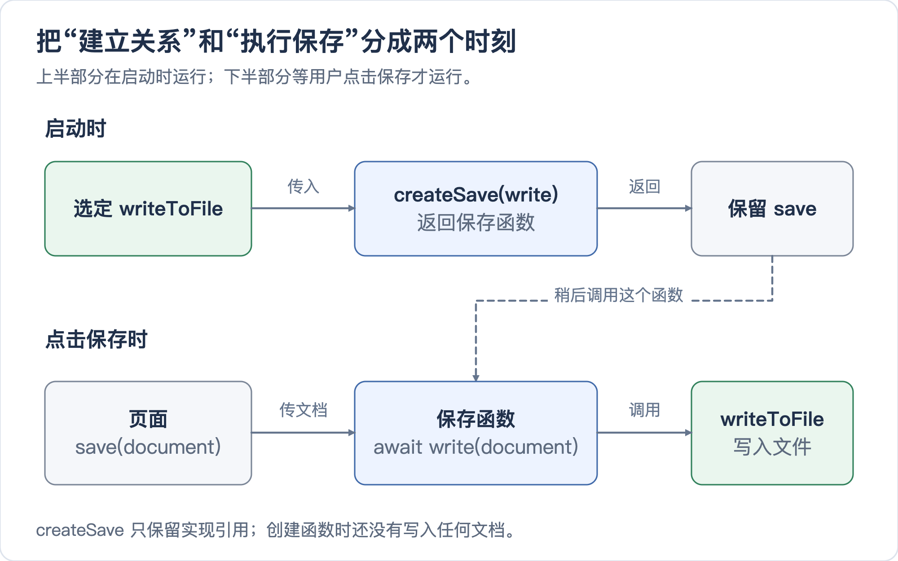

图 2：启动时创建并保留保存函数，点击保存时才传入文档。两行里的 save 是同一个函数。

普通参数传递到这里仍然够用。下一步来自新的目标：我们希望功能能分别加入程序，启动代码只选择加入哪些功能，而不必替每个功能编写内部连接关系。

## 5. 让功能自行连接，需要一个共同的查找位置

目前启动代码写着：

```ts
const save = createSave(writeToFile);
```

它既知道写入实现，也知道保存功能需要这个实现。更多功能加入后，它还要继续处理“读取需要谁、搜索需要谁”等关系。

我们希望这些关系由功能自己负责：存储功能登记写入实现，保存功能查找它，再创建保存函数。启动入口只决定要加入哪些功能。

这样就缺少一个公共交接位置。先用 Map 表达：

```js
const capabilities = new Map();

capabilities.set("document/write", writeToFile);

const write = capabilities.get("document/write");
const save = createSave(write);
```

这张表保存“能力标识 → 实现”。提供者写入，使用者按同一标识读取；查询结果仍然是普通函数，调用它才发生业务操作。

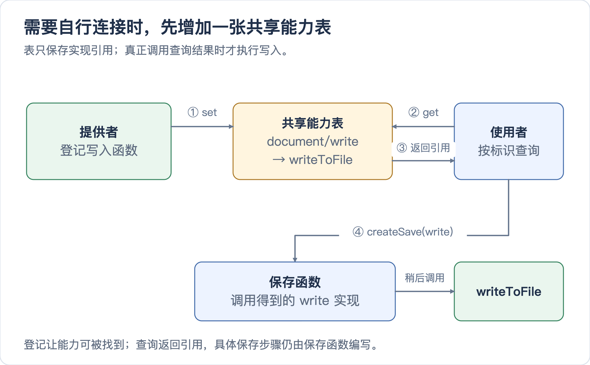

图 3：按编号看登记、查询和创建过程；下方的实际调用发生在收到保存请求之后。

再把登记和查询分别移到各功能的初始化函数：

```js
function startStorage(capabilities) {
  capabilities.set("document/write", writeToFile);
}

function startSave(capabilities) {
  const write = capabilities.get("document/write");
  capabilities.set("document/save", createSave(write));
}

const capabilities = new Map();

for (const start of [startStorage, startSave]) {
  start(capabilities);
}
```

现在，启动代码只调用统一形式的初始化函数，并传入同一张表。具体能力如何连接，已经由各功能自己编写。

这个顺序暂时还是人工安排的：先存储，后保存。后面再解决自动排序。

## 6. 查找位置有了，再明确标识和登记规则

两边分别填写 `"document/write"` 容易出现拼写不一致，所以先把它放在共享模块里：

```js
export const storageName = "document/write";

capabilities.set(storageName, writeToFile);
const write = capabilities.get(storageName);
```

共享常量解决拼写问题，但还没有关联能力类型。不同契约如果恰好同名，也可能占用同一个位置。

当前设计因此选择**共享的类型化标识** `ServiceKey<T>`：保留名称用于说明，用唯一 token 区分运行时身份，并关联能力类型。

业务契约模块创建并导出：

```ts
export const storageKey =
  createServiceKey<WriteDocument>("document/write");

export const saveKey =
  createServiceKey<SaveDocument>("document/save");
```

`storageKey` 关联 `WriteDocument`，所以按它登记和查询时保留写入函数的类型检查。泛型用于关联类型，不会自动校验运行时数据。

提供者和使用者必须导入同一个 key。当前 token 由 `Symbol` 创建；分别创建两个同名 key，仍然是两项不同能力。

### 从 Map 到能力注册表 C

普通 Map 还缺少系统需要的规则。例如查不到能力时应立即报错；同一能力来了两个实现，也必须明确处理，不能静默覆盖。

当前先选择一个 key 只有一个提供者。重复登记报错，由应用决定采用哪一个实现。

把登记、查询和检查集中起来，就是**能力注册表 C**，当前类名为 `CapabilityRegistry`：

```text
登记：收到能力 key 和实现，保存对应关系
查询：收到 key，返回对应实现
缺失或冲突：明确报错
```

它还会记录实现属于哪个插件，供卸载时清理。这个归属如何建立，下一节继续推导。

C 管理的是能力查找，不执行写入，也不规定保存步骤。最终由 Core 创建并持有；它的来源仍然是前面那张共享表。

## 7. 从初始化函数，得到插件和 Core

前面已经让每项功能有了初始化函数。现在再要求功能可以在运行时加入和移除。

只有初始化函数还不够：功能可能打开文件句柄、创建定时器，移除时需要对应的清理代码。管理者也需要一个 ID，才能找到指定功能。

因此，功能作者要交出：

- `id`：标识这个功能。
- `activate`：初始化并注册能力。
- 可选的 `deactivate`：释放自己创建的资源。

把这些放在一个对象里，形成统一格式，这样的功能组件就是**插件 P**。下一节再补上依赖声明，才得到当前完整的 `Plugin` 接口。

### 谁来执行这些方法

之前的启动循环执行完就结束了，没有持续接收加入、移除请求的入口，也没有保存已启动组件供后续清理。

因此，把这部分扩展为一个管理对象：持有 C，接收插件并调用初始化，记录成功加入的插件，移除时调用清理。

这个对象就是**内核 Core**，当前类名为 `EngineCore`。应用启动入口创建一个实例：

```ts
const core = new EngineCore();
```

Core 创建 C，并保存原插件对象。C 保存插件提供的能力实现。两者分开，是因为停止插件要调用原对象的清理方法，业务调用则需要取得它提供的能力；一个插件也可以提供多项能力。

把插件交给 Core 加入运行，叫**挂载**；调用 `activate` 完成初始化，叫**激活**；停用并移除插件，叫**卸载**。

### 为什么增加 PluginContext

卸载时需要删除插件留下的能力，因此每项登记都必须有提供者 ID。

Core 调用某个插件的 `activate` 时，已经知道这个 ID。让插件再次填写没有必要，也容易写错。因此，Core 为当前插件创建专用的 `PluginContext`：

```text
Core 接收 file-storage
  → 创建绑定 file-storage ID 的 context
  → 调用 activate(context)
  → 插件调用 context.provide(key, value)
  → Core 接收实现，并自动记录提供者 ID
```

`context.get(key)` 则负责查询 C。它也是后面执行访问检查的入口。

这不是新的业务层，而是插件操作内核的接口。各插件拿到自己的 context，底下连接同一个 Core 和同一张 C。应用使用一个内核，不为各插件单独创建内核。

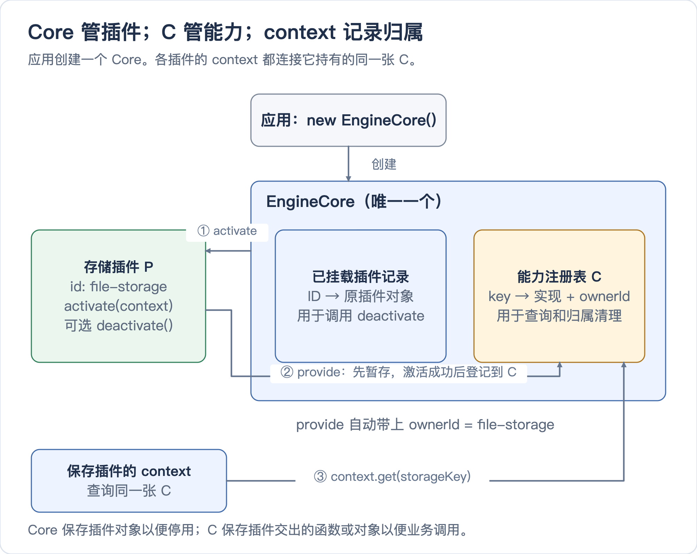

图 4：Core 保存插件对象，C 保存能力实现。provide 和 get 经由各自的 context 操作同一张 C，登记时自动带上插件归属。

## 8. 初始化之前，先知道谁需要谁

手工按“存储 → 保存”初始化可以工作。若顺序相反，保存先查询写入能力，表里还没有实现，就会失败。

Core 不理解保存业务，不能凭插件名判断先后。要提前排顺序，插件必须提前说明自己需要什么、承诺提供什么：

- `requires`：必需能力。
- `provides`：激活成功前必须注册的能力。

这就是**依赖声明**。作者填写关系，Core 根据关系检查和排序，而不通过执行业务代码来猜测。

结合前面的函数和 key，完整插件可以写成：

```ts
const storagePlugin: Plugin = {
  id: "file-storage",
  requires: [],
  provides: [storageKey],

  activate(context) {
    context.provide(storageKey, writeToFile);
  },
};

const savePlugin: Plugin = {
  id: "document-save",
  requires: [storageKey],
  provides: [saveKey],

  activate(context) {
    const write = context.get(storageKey);
    context.provide(saveKey, createSave(write));
  },
};
```

业务操作仍是前面已有的登记、查询和创建保存函数。`requires/provides` 必须填写，没有内容就用 `[]`。

**声明和注册不是同一件事：** `provides` 在激活前说明承诺，`provide` 在激活中交出实现。

### 从声明得到启动顺序

应用可以传入：

```ts
await core.mountAll([savePlugin, storagePlugin]);
```

Core 先读取整批声明。对于保存需要的 `storageKey`，先查 C；如果已经注册，依赖已满足。否则查本批次谁声明提供它，得到“保存必须等存储”的关系。

两处都没有提供者就报依赖缺失。同一 key 有多个提供者就报冲突，由应用选择。匹配只发生在已挂载插件和本批次插件之间，不会自动寻找外部代码。

接下来只生成顺序，还不调用 `activate`：

1. 找到不再依赖本批次未排序插件的候选。
2. 将它放入启动顺序，从待排序名单移除。
3. 更新其他插件尚待排序的依赖，再选下一项。

同时有多个候选时，每一步选原输入顺序最靠前的插件。于是本例虽然保存在前，实际仍是存储先激活成功，保存再取得写入能力。

多个使用者可以共享提供者，所以这些关系是依赖图。同一个使用者需要某提供者的多项能力，只记一次插件间依赖。

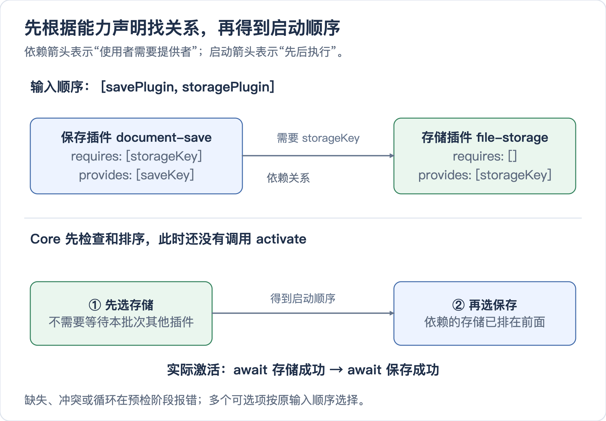

图 5：保存依赖存储，所以依赖箭头指向存储；执行时恰好反过来，先准备存储，再准备保存。

### 如果无法选出起点

假设 A 要等 B 的写入能力，B 又要等 A 的保存能力：

```text
A --[document/write]--> B --[document/save]--> A
```

双方都必须先等对方，没有合法起点。这是**循环依赖**。当前 Core 在任何激活开始前拒绝整批挂载，并报告实际循环链和相关能力。

只依赖 A 的下游插件会受阻，但不属于这个循环，诊断不会把它列为循环成员。插件依赖自己尚未提供的能力也按循环处理；自身能力可以在注册后读取，无须声明为外部依赖。

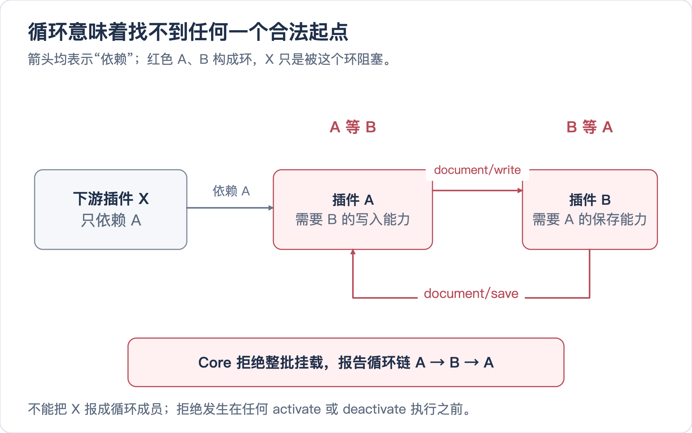

图 6：A 和 B 互相等待，构成实际循环；X 受影响，但不是环的一部分。此时整批尚未开始激活。

解开循环需要作者调整业务关系，例如提取共同能力。Core 无法替业务决定哪条依赖可以删掉。

### 实际访问也要遵守声明

如果声明没有依赖，激活时却读取存储能力，前面的排序就失去依据。所以：

- `context.get` 只能访问声明的依赖或本插件已提供的能力。
- `provide` 只能注册 `provides` 中的能力。
- 声明自己提供某项能力，不代表能读取别的提供者。

Core 保存本次 ID 和声明副本，后续修改原数组不会改变检查结果。重复 ID、重复声明、提供冲突、缺失依赖和循环，均在批量激活前报错；此时不调用初始化或清理函数。

单插件 `mount(plugin)` 要求依赖已在 C 中。批量 `mountAll(plugins)` 才根据本批次声明排序。

## 9. 顺序正确，还要保证实现已经准备好

声明只证明有人承诺提供能力，不证明初始化一定成功。插件可能出错，也可能漏注册一项能力。

若注册一项就立刻公开，调用者可能看到只完成了一部分的插件。因此，当前方案先暂存注册，激活成功后才公开：

```text
确认依赖已注册，且提供者未在执行挂载或卸载
  → 记录实际提供者，创建 context
  → 调用并等待 activate，provide 的能力先暂存
  → 检查全部 provides 已注册，且提交无冲突
  → 一次提交该插件的全部能力
  → 记录挂载成功，再激活下一插件
```

激活期间，插件可以读取自己已暂存的能力，其他插件看不到它们。一次提交的范围是单个插件；整批仍然逐个提交，已提交能力可以查询。

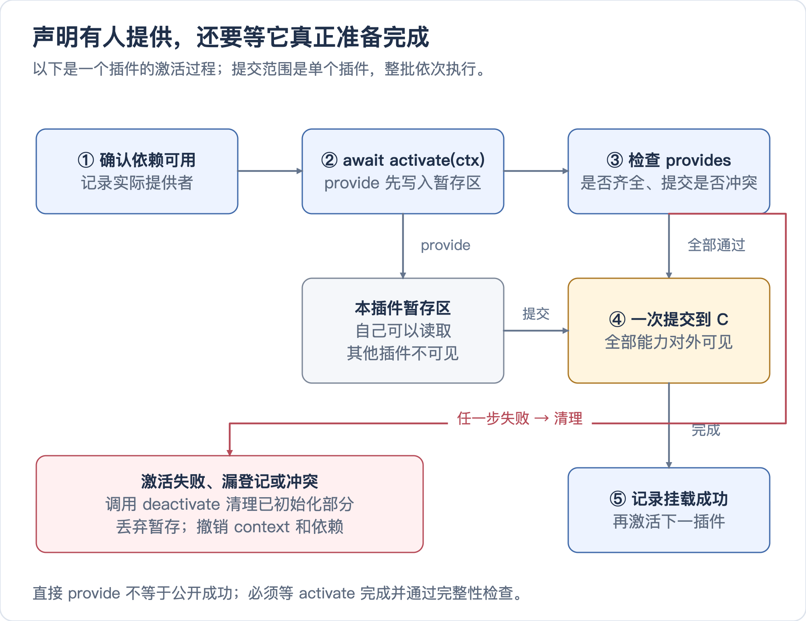

图 7：暂存区与 C 之间有明确边界。准备和检查都成功，才公开该插件的全部能力；失败则转入清理。

全部挂载成功后，页面取得保存函数：

```ts
const save = core.get(saveKey);
await save(document);
```

宿主通过 `core.get` 查询，业务插件通过自己的 `context.get` 查询。取得实现后直接调用，Core 不逐次代替业务执行。

“先校验，再写入，失败时补偿”这类业务步骤，仍由保存插件编写。Core 管的是准备与清理，不决定保存流程。

## 10. 从直接调用，推导出事件通知

现在保存成功后需要记录日志，未来还可以加入统计插件。日志和统计可以分别启用或停用，而保存流程应保持稳定。

直接调用当然能工作：

```ts
await write(document);
recordSave(document.id);
```

但每增加一种响应，保存代码就要增加一个依赖和一次调用。要满足前面的目标，需要让响应者自行登记，而保存只宣布结果。

先只考虑保存完成，用回调列表表达：

```js
const savedListeners = [];

savedListeners.push(recordSave);

// 保存成功后
for (const listener of savedListeners) {
  await listener(document.id);
}
```

响应者登记函数，保存成功时再调用这些函数。这就是订阅与通知的基本过程。

如果还有“文档打开”等消息，就再按事件标识分开列表：

```text
保存完成的标识 → 保存完成的监听列表
文档打开的标识 → 文档打开的监听列表
```

这张表就是**事件订阅表**。C 按能力找到一个实现来完成工作；事件表按事件找到一组监听，通知它们某件事已经发生。

以下事件机制已在 `src/plugin-core` 实现。第一版处理通知，通过 `createEventKey` 定义共享标识，插件通过 `on/emit` 订阅和发布。

### 先明确事件含义，再定义共享标识

“保存完成”可能被理解为按钮已点击，也可能被理解为文件已写入。业务作者必须先约定准确含义。

本例由保存插件在 `write(document)` 成功后发布，表示写入已经完成，数据包含文档 ID：

```ts
export const documentSaved = createEventKey<{
  documentId: string;
}>("document/saved");
```

`EventKey<T>` 将共享事件标识与 payload 类型关联。发布者和监听者导入同一个 key，按同一类型发送、接收；泛型不替代运行时校验。

`createEventKey` 创建带有唯一 `token` 的标识，不向 Core 注册。即使两个 key 的名称相同，各自创建的 token 也不同，因此发布者和监听者必须导入同一个定义。

事件含义和触发位置属于业务契约。新增事件无需修改内核的业务枚举，内核也不推断“保存完成”发生了没有。

### 谁管理订阅表

监听还需要取消，并在所属插件停用时清理。Core 已经知道插件 ID，也负责其生命周期，所以把这张表交给 Core 持有。

管理订阅表及分发操作的对象叫 **EventBus，事件总线**。应用创建一个 Core，Core 创建一个 EventBus。各插件的 context 增加：

- `on(key, listener)`：记录事件、监听函数及当前插件 ID，返回取消函数。
- `emit(key, payload): Promise<void>`：按标识查找监听，传入数据，等待本次通知完成。

所有 context 连接同一张订阅表。`get/provide` 继续连接 C；`on/emit` 连接 EventBus。内核管理这些关系，不包含文档或日志业务。

表的结构是 `Map<symbol, 监听记录[]>`，key 是事件的 token，每条记录保存监听函数、插件 ID 和是否已生效。首次 `on` 创建列表，`emit` 查不到监听时直接完成，因此不需要发布者提前登记事件；取消最后一条订阅时删除该条目。

### 日志激活时订阅

```ts
const logPlugin: Plugin = {
  id: "save-log",
  requires: [],
  provides: [],

  activate(context) {
    context.on(documentSaved, ({ documentId }) => {
      console.log("文档已保存：" + documentId);
    });
  },
};
```

Core 调用 `activate`，日志把回调登记进去，暂时不执行。激活期间订阅先暂存，`activate` 完成且声明的能力全部提交成功后生效，失败时丢弃。激活后调用 `on` 则立即生效。

### 保存执行时发布

保存插件仍先取得写入函数，再提供保存函数。为这个函数加上成功后的发布：

```ts
const write = context.get(storageKey);

context.provide(saveKey, async (document: DocumentData) => {
  await write(document);

  try {
    await context.emit(documentSaved, {
      documentId: document.id,
    });
  } catch (error) {
    console.error("文档已写入，但保存通知处理失败", error);
  }
});
```

用户点击保存才执行这段业务：先写入，成功后调用 `emit`；写入失败则不发布。EventBus 查到日志监听，把文档 ID 交给它并等待完成。

这里单独处理通知错误，是保存插件的业务选择，避免把日志失败表达成写入失败。监听出错不会自动撤回已写入的文件。

事件切入点就是业务里明确写出的 `emit`。Core 不扫描代码、不监视文件，也不自动生成这些业务事件。

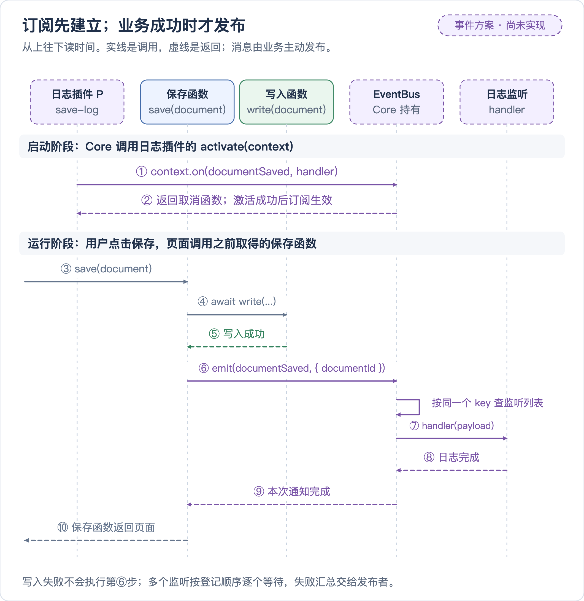

图 8：时间从上往下走。日志在启动时订阅，保存函数在写入成功后发布，EventBus 按 key 找到监听并调用。

### 为什么要明确分发规则

监听自身可能添加或取消订阅，所以一次发布先复制当前已生效的列表。本次发布开始后新增或刚完成激活的监听，下次发布才能收到通知；已取消且尚未开始的监听跳过，已经开始的异步回调继续完成。

发布者需要知道本次通知何时结束，因此 `emit` 等待监听完成。第一版选择按登记顺序逐个等待，让执行顺序明确；没有监听时正常完成。

日志失败不应阻止统计收到消息，所以一个监听失败后仍继续其他监听，最后抛出 `EventDispatchError`。其中的 `eventId` 保存事件名称，`listenerErrors` 保存各失败监听的 `pluginId` 和原始 `error`。监听返回值不用于修改或阻止业务流程。

订阅也不要求发布者已挂载，先登记、以后接收即可。因此，事件订阅不计入 `requires/provides`；监听若要调用某项能力，仍须声明那项能力。

## 11. 事件公开之后，其他插件怎样接入

运行时的订阅表只记录“谁订阅了什么”，不包含所有可能的事件，也不解释业务含义。

插件作者需要查阅公开事件定义和文档，了解发布者、payload、准确发布位置及执行规则，再导入共享 key 并编写监听。文档应对应契约和实际发布代码，使用者不必阅读整个系统内部实现。

新增事件 E 时，作者公开共享标识和含义，在业务位置调用 `emit(E, data)`；其他作者据此决定是否增加 `on(E, handler)`。

已有插件必须增加订阅代码才会响应 E，未来插件也按公开契约接入。发布事件不会让插件自动理解新业务。能力注册同样只提供可查找条件，不会让旧流程自动采用新能力。

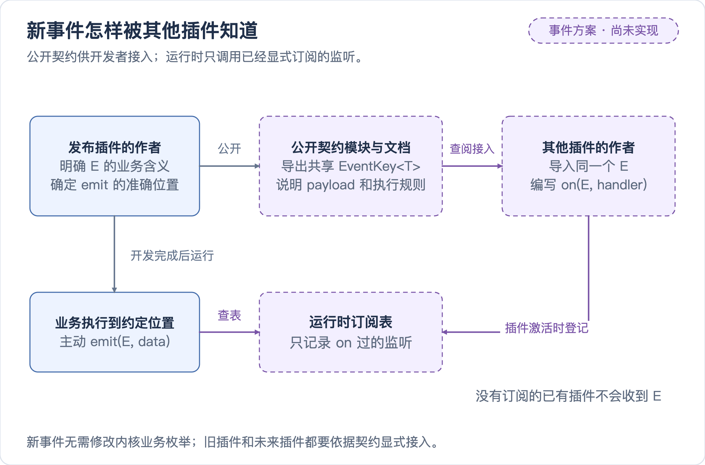

图 9：上面是开发者通过公开契约接入，下面是运行时按订阅记录分发；公开事件本身不会自动增加监听。

### 通知不自动赋予介入流程的权限

保存完成后的事件已经晚于写入。如果要求插件校验、修改参数或阻止保存，流程作者必须另行开放位置，并约定返回值如何改变后续执行。

需要包装一次调用时，可以另定 `next()` 协议，说明怎样继续、结束后怎样处理，以及是否允许不调用 `next()`。这些尚未进入第一版通知方案。

未公开调用边界、也未发布事件的内部位置，没有外部接入入口，需由拥有该逻辑的插件明确增加。

### 共享状态仍要有负责人

例如当前文档可以由一项状态能力持有，提供读取、修改接口，其他插件通过能力契约访问。变化后需要提醒其他插件，再发布对应事件。

这样，状态由谁维护、怎样更新、何时通知都有明确位置。事件负责通知，不代替状态管理。

## 12. 挂载之外，还要完成卸载和失败清理

正常卸载之前，先检查是否还有插件依赖目标提供者。本例保存使用存储，保存未停用时不能先卸载存储，否则它可能继续调用已经停用的实现。

因此，Core 保存“使用者 → 实际提供者”的依赖记录。有人仍依赖目标插件时拒绝卸载，并列出依赖者：

```ts
await core.unmount("document-save");
await core.unmount("file-storage");
```

日志只订阅保存事件，没有依赖保存能力，可以单独卸载。

允许卸载时，Core 调用并等待 `deactivate`，随后撤销该插件的能力、挂载和依赖记录，使旧 context 失效。同一清理过程撤销它的全部订阅，也禁止旧 context 继续订阅或发布；`deactivate` 尚未结束时，context 和订阅仍然可用。

即使 `deactivate` 抛错，内核登记仍要清理。文件句柄、定时器等插件自有资源，由停用函数释放。

依赖记录覆盖激活、失败清理和停用期间，直到清理完成，避免提供者在异步阶段被提前移除。撤销登记不会销毁已经取出的普通引用，也不会强制中断已开始的回调，调用方仍要遵守插件生命周期。

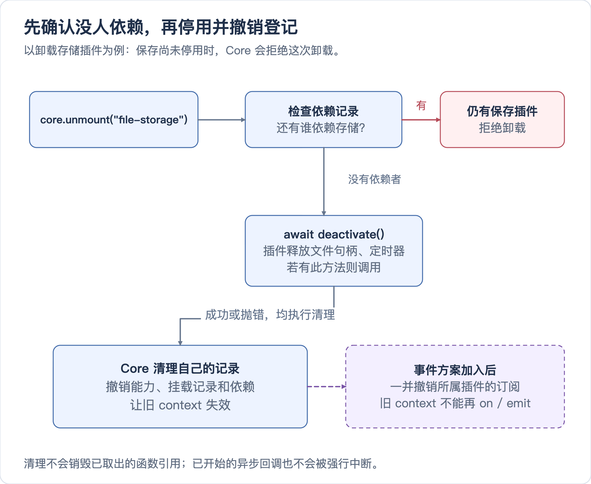

图 10：先检查是否有人依赖目标插件，再等待它释放资源，最后撤销内核记录，包括订阅清理。

### 激活失败也要清理

插件可能只完成部分初始化就失败。Core 因此也调用它的 `deactivate`，丢弃暂存能力和订阅，撤销归属登记，使 context 失效并释放依赖。

停用函数必须能处理部分初始化。它出错也不能阻止 Core 清理自己的记录。

批量挂载失败时，先清理失败插件，再逆序卸载本批次已成功插件，保留开始前已有插件。逆序是为了先移除使用者，再移除提供者。

某个回滚清理失败也继续处理其余插件，并保留原始错误和清理错误。回滚处理生命周期和登记，不自动撤回此前的任意外部业务效果。

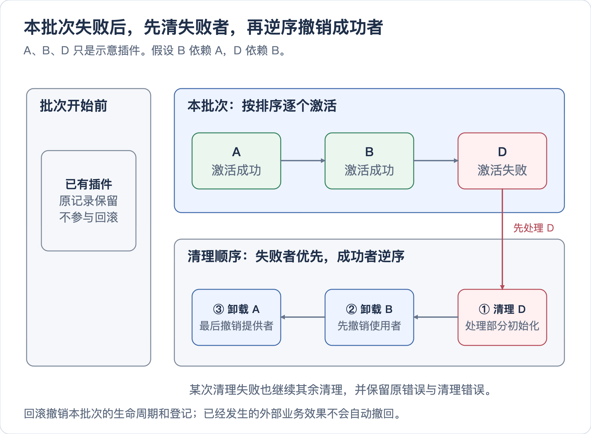

图 11：用 A、B、D 示意失败回滚。先清理失败的 D，再撤销 B、A；批次开始前已有的插件保留。

### 防止检查后的关系又被改变

如果另一项挂载或卸载在本批次处理中改变关系，刚完成的检查可能失效。

所以，批量预检、激活和回滚期间拒绝其他生命周期操作；已有单插件正在挂载或卸载时，也拒绝开始批量装配。能力查询仍可以使用。

## 13. 将整套架构放回一次实际运行

现在才把前面得到的机制放在一起。包含事件通知的完整例子这样启动：

```ts
const core = new EngineCore();

await core.mountAll([
  logPlugin,
  savePlugin,
  storagePlugin,
]);
```

日志和存储都没有能力依赖，按输入顺序先选日志，再选存储，最后选保存。实际激活顺序为：

```text
save-log → file-storage → document-save
```

日志登记订阅，存储提交写入能力，保存取得写入实现并提交保存能力。日志提前订阅没有问题，因为发布者不必先存在。

启动完成后，内核保留：

| 记录 | 保存内容 | 用途 |
| --- | --- | --- |
| 已挂载插件 | 插件 ID → 原插件对象及 context 撤销方法 | 停用、撤销入口 |
| C | 能力 key → 实现及提供者 ID | 查询、按归属清理 |
| 依赖关系 | 使用者 → 提供者 | 防止提供者提前卸载 |
| 事件订阅表 | 事件 token → 监听列表及归属 | 分发通知、撤销订阅 |

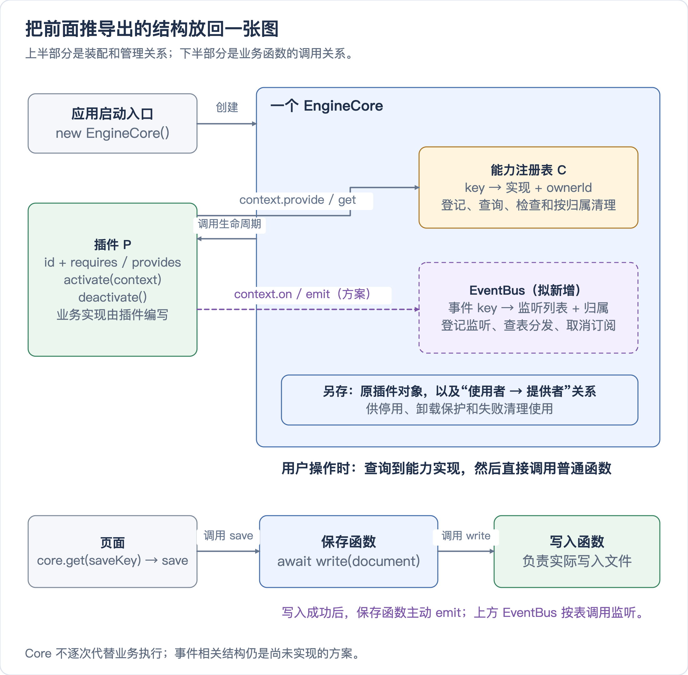

图 12：现在才把前面的机制合在一起。Core 管准备与清理，C 交出能力实现，业务函数负责实际工作，EventBus 查表通知监听。

Core 调用的是插件的生命周期方法；页面调用的是 C 返回的能力实现。C 不要求把整个插件对象当成能力存入。

用户点击保存时，执行链是：

```text
页面调用保存函数
  → 保存函数调用写入函数
  → 写入成功后发布 documentSaved
  → EventBus 查表并调用日志监听
  → 等待监听结束
  → 保存函数返回
```

业务含义和步骤由插件决定。内核管理插件、标识、声明、实现、回调及归属，不需要理解文档或日志业务。

这就是本文所说的完整骨架：主要业务能力和流程遵守统一的装配、协作与卸载规则，也就是“一切皆插件”。插件内部仍可使用普通函数，不要求每个函数都成为插件。

## 14. 设计与当前代码的界限

设计链路完整，不代表代码已经全部完成。当前状态如下：

| 部分 | 当前状态 |
| --- | --- |
| Core、C、Plugin、能力 key、context 的 `get/provide` | `src/plugin-core` 已实现 |
| `requires/provides`、依赖记录、访问约束、提供完整性检查、卸载保护 | 已实现 |
| `mountAll` 整批预检、稳定排序、循环诊断、顺序激活、失败回滚、生命周期互斥 | 已实现 |
| `EventKey<T>`、EventBus、`on/emit`、订阅暂存与自动撤销 | 已实现，包含监听错误汇总 |
| `unmountAll` 按激活逆序停止、继续清理并汇总错误 | 已实现 |
| 主题插件、通用运行实例及实际启动接入 | 已实现；UI 仍由入口直接组装 |
| 本文的存储、保存、日志插件 | 教学示例，未接入实际业务 |
| UI 插入位置、组件贡献、批次提交及停用前 UI 撤回 | [目标设计](/Users/yinzhenpu/projects/Lodestory/文档/一切皆插件架构/UI插件化设计.md)，尚未实现 |
| 外部插件发现和加载、多提供者选择、事件目录生成、流程拦截协议 | 尚未实现 |

现有业务的第一阶段接入顺序和逐步验收条件见[项目插件化接入流程](/Users/yinzhenpu/projects/Lodestory/文档/需求设计/项目插件化接入流程.md)。

插件提供 UI 后，还需要在停止服务前撤回组件，并等待组件清理确认。该扩展及撤回失败时保留服务的规则见子文档[UI 插件化设计](/Users/yinzhenpu/projects/Lodestory/文档/一切皆插件架构/UI插件化设计.md)；第 12 节描述的是当前已实现的停用行为。

单插件激活和清理同时失败时，`PluginActivationError` 保留两项错误；批量回滚出现额外失败时，`PluginBatchActivationError` 保留失败插件 ID、原始激活错误和各项回滚错误。没有额外回滚错误时，直接抛出原始激活错误。

`plugin-architecture-lab` 是早期用 Rust 验证 Core、C、P 关系的实验；当前 TypeScript 实现在 `src/plugin-core`。

这里的动态挂载和卸载，首先指管理已经编译进程序的插件实例。从外部安装、加载插件代码是另外的能力，尚未实现。

## 参考：DSH 的对应做法

DSH 同样先公开能力接口，由提供者实现，使用者通过契约调用。可以对照其[架构说明](https://github.com/deepseek-ai/deepseek-harness/blob/master/docs/architecture.md)、[Cordis 入门](https://github.com/deepseek-ai/deepseek-harness/blob/master/docs/cordis-primer.md)和[服务开发说明](https://github.com/deepseek-ai/deepseek-harness/blob/master/docs/user/develop/framework/service.md)。[能力地图](https://github.com/deepseek-ai/deepseek-harness/blob/master/docs/capability-seams.zh.md)列出了公开能力和接入位置。

事件也是“公开定义 → 显式订阅 → 业务主动发布”。DSH 用字符串事件名，通过扩展 TypeScript 的 `Events` 接口声明参数，并从声明生成事件参考目录；本方案使用共享 `EventKey<T>`。表达方式不同，但双方都需要依据公开契约接入。[事件定义与目录说明](https://github.com/deepseek-ai/deepseek-harness/blob/master/docs/user/develop/framework/events.md)

例如工具包在确定最终结果后发布 `tools/result`，日志插件通过 `ctx.on('tools/result', handler)` 订阅。DSH 这条通知隔离并记录监听错误，不等待异步监听完成；本方案拟逐个等待并汇总抛错，执行规则不同。[订阅示例](https://github.com/deepseek-ai/deepseek-harness/blob/master/docs/user/develop/framework/events.md#L284)、[发布代码](https://github.com/deepseek-ai/deepseek-harness/blob/master/packages/core/tools/src/index.ts#L1603)

DSH 还在 `tools/pre-execute`、`tools/execute`、`tools/post-execute` 等位置开放修改、包装或截断规则。允许介入哪一步、怎样影响后续流程，来自具体事件契约。本项目第一版先采用通知机制。[工具执行流程](https://github.com/deepseek-ai/deepseek-harness/blob/master/docs/tool-execution-pipeline.md)、[事件执行约定](https://github.com/deepseek-ai/deepseek-harness/blob/master/docs/cordis-primer.md)
